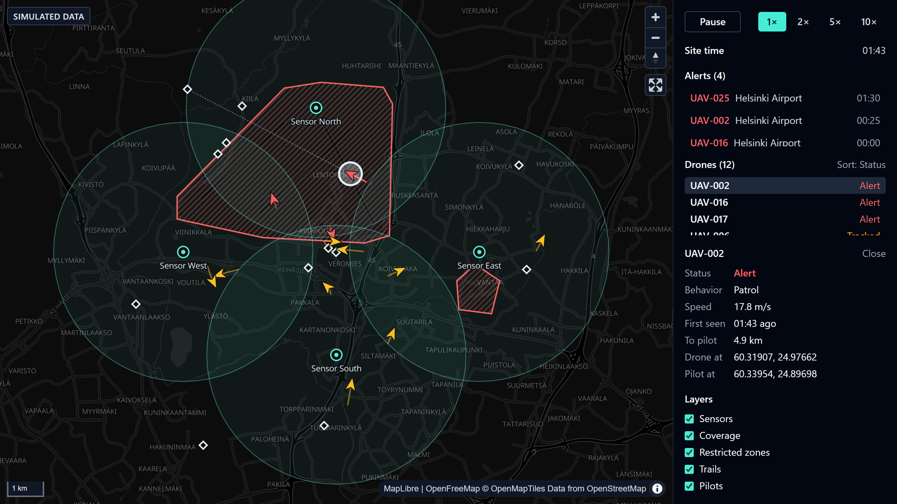

# Airspace Monitor

A browser-based operator view for drone detection. Simulated drones fly over Vantaa, Finland, while fictional sensors detect them. The live map shows drones, their pilots, sensor coverage and restricted-zone alerts.

**[Open the live demo](https://hoang0211.github.io/airspace-monitor/)**

> **All data is simulated.** Drones and pilots come from a built-in simulator. Sensor sites and zones are fictional and approximate, not real aviation data.



## What it does

- **Live map:** drones move every second, with their recent trail. Sensor coverage and restricted zones are drawn underneath.
- **Detection status:** each drone shows as undetected, tracked or alert, in both color and text.
- **Alerts:** a new alert appears and flashes briefly when a drone enters a restricted zone.
- **Drone list:** every drone with its status, sorted with alerts first. Click a row to select the drone and fly the map to it.
- **Details:** hover a drone to highlight it, or click it to see its behavior, speed, distance to its pilot and when it was first seen. The link to its pilot appears on the map. If the drone disappears, the panel reports the lost contact.
- **Simulation controls:** pause, or run at 1×, 2×, 5× or 10× speed, with a site clock that alert times are measured against.
- **Layers:** show or hide sensors, coverage, zones, trails and pilots.

It works on phones too, with the panel under the map and its sections in tabs.

It's a demonstration project. It doesn't use real sensor data and has no way to act on a drone.

## Stack

- **Language and UI:** [TypeScript](https://www.typescriptlang.org) and [React](https://react.dev)
- **Map:** [MapLibre GL JS](https://maplibre.org), with an [OpenFreeMap](https://openfreemap.org) basemap and [Turf](https://turfjs.org) for geometry
- **State:** [Zustand](https://zustand.docs.pmnd.rs)
- **Styling:** [Tailwind CSS](https://tailwindcss.com)
- **Build:** [Vite](https://vite.dev)
- **Testing:** [Vitest](https://vitest.dev) and [React Testing Library](https://testing-library.com/docs/react-testing-library/intro) for unit and component tests, and [Playwright](https://playwright.dev) for a smoke test
- **Linting and formatting:** ESLint and Prettier
- **CI and hosting:** GitHub Actions checks every push, and deploys to GitHub Pages once the checks pass

## Design decisions

### Why live data skips React

Every tick, the map gets new drone data through MapLibre's `source.setData()`, straight from the simulation loop. If that data went through React state, every tick would re-render the map component for no benefit, since MapLibre draws the map itself.

React only gets what the side panel shows: the site time, any new alerts and a small summary of each drone. So a tick is one small store update. In testing, a tick with 50 drones took about 0.2 ms on average, and memory stayed flat over 100 simulated minutes.

### Status and alerts

A drone's status is worked out on every tick:

- **Undetected:** no sensor is in range. This includes a drone inside a restricted zone that no sensor covers, because nothing is there to report it.
- **Tracked:** a sensor is in range, and the drone is outside every restricted zone.
- **Alert:** a sensor is in range, and the drone is inside a restricted zone.

An alert is raised once, when a drone enters a zone, not on every tick it stays inside. Leaving and re-entering raises a new one. The list keeps the 20 newest, timed against the site clock, so they can be compared with the current time.

### What changes at 1,000+ tracks

The current design suits dozens of drones. With thousands, a few things would change:

- **Map updates:** sending every feature on every tick gets expensive, so only changed features would be sent, with `GeoJSONSource.updateData()`, and drones would be clustered when zoomed out.
- **React updates:** a summary of every drone each tick would be too much, so the panel would get only counts and the rows on screen, with a virtualized list.
- **Detection:** checking every drone against every zone would need a spatial index, so each drone only checks the zones near it, wherever classification runs.
- **Processing:** handling thousands of track updates would move into a web worker, so it doesn't compete with drawing the map. In a real system, much of it, such as classifying tracks and raising alerts, would happen on a server.
- **Alerts:** many alerts at once would need grouping, so an operator isn't flooded.

## Development

You'll need [Node.js](https://nodejs.org). Then run:

```bash
npm install
npm run dev
```

Vite prints a local URL to open in your browser. Other commands:

```bash
npm test             # unit and component tests
npm run test:e2e     # Playwright smoke test against the production build
npm run lint
npm run typecheck
npm run build
```

The smoke test needs a Playwright browser. If it asks for one, run `npx playwright install chromium` once.
